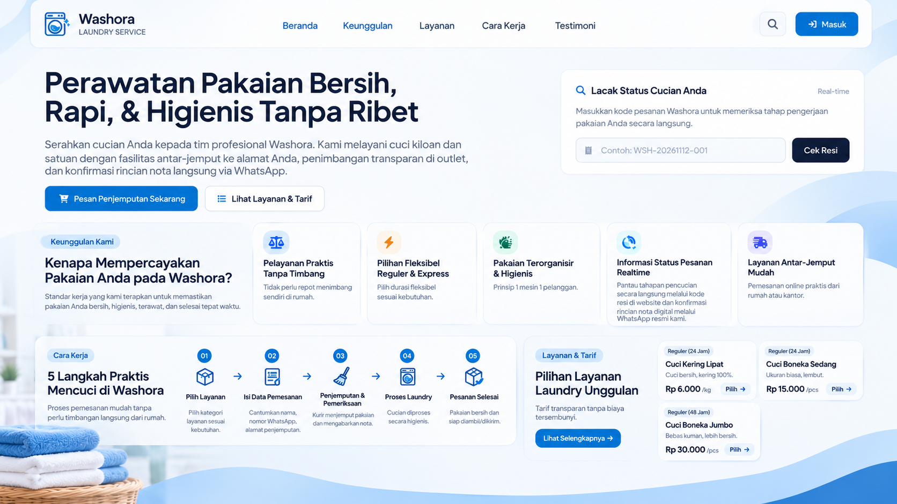

<p align="center">
  
</p>

<h1 align="center">Washora — Sistem Informasi Laundry</h1>

<p align="center">Aplikasi berbasis website untuk pemesanan dan pengelolaan layanan laundry.</p>

<p align="center">
  <a href="https://washora-laundry-system.wasmer.app">Kunjungi website demo</a>
</p>

<p align="center">
  
  
  
  
</p>

## Tentang Washora

Washora membantu pelanggan melihat pilihan layanan, membuat pesanan, dan memantau progres laundry. Administrator dapat mengelola layanan serta pesanan dan memantau transaksi melalui satu aplikasi.

## Fitur Utama

### Pelanggan

- Registrasi dan login.
- Melihat layanan dan paket laundry, termasuk pilihan reguler dan express.
- Memesan layanan laundry kiloan maupun satuan.
- Melihat riwayat, rincian, dan status pesanan.
- Melacak pesanan menggunakan kode pesanan.
- Mengirim ulasan dan testimoni setelah pesanan selesai; testimoni ditampilkan setelah disetujui administrator.

### Administrator

- Dashboard ringkasan pesanan, pelanggan, layanan, dan pendapatan.
- Mencari serta melihat data pelanggan dan riwayat pesanan.
- Mengelola kategori, layanan, dan paket laundry.
- Memilih dan mengatur urutan layanan unggulan di halaman utama.
- Memverifikasi pesanan dan memperbarui statusnya.
- Melihat transaksi, mencetak invoice, serta melihat rekapitulasi laporan.
- Mencetak atau mengunduh laporan transaksi dalam format PDF.
- Meninjau, menyetujui, dan menghapus testimoni.

## Tampilan Website

<p align="center">
  
</p>

## Teknologi yang Digunakan

| Teknologi | Fungsi | Versi pada proyek |
|---|---|---|
| PHP | Bahasa pemrograman sisi server | `^8.3` |
| Laravel | Framework aplikasi web | `^13.17` |
| MySQL | Database bawaan konfigurasi contoh | — |
| Tailwind CSS | Utilitas styling antarmuka | `^4.0` |
| Vite | Bundling aset frontend | `^8.0` |
| Laravel DomPDF | Pembuatan laporan PDF | `^3.1` |

## Instalasi

Pastikan PHP 8.3+, Composer, Node.js, NPM, dan MySQL tersedia.

1. Clone repository dan masuk ke folder proyek:

   ```bash
   git clone https://github.com/kayla-pum/washora_laundry_system.git
   cd washora_laundry_system
   ```

2. Pasang dependency:

   ```bash
   composer install
   npm install
   ```

3. Salin `.env.example` menjadi `.env`, lalu sesuaikan konfigurasi koneksi database untuk lingkungan Anda. Buat database MySQL yang sesuai sebelum menjalankan migrasi.

   ```powershell
   Copy-Item .env.example .env
   ```

   macOS/Linux:

   ```bash
   cp .env.example .env
   ```

4. Buat application key:

   ```bash
   php artisan key:generate
   ```

5. Jalankan migrasi dan seeder untuk menyiapkan tabel serta data awal:

   ```bash
   php artisan migrate --seed
   ```

6. Kompilasi aset frontend dan jalankan aplikasi:

   ```bash
   npm run build
   php artisan serve
   ```

   Buka `http://127.0.0.1:8000` di browser.

## Akun Demo

| Peran | Email | Kata sandi |
|---|---|---|
| Pelanggan | [user@washora.com](mailto:user@washora.com) | `password` |
| Administrator | [admin@washora.com](mailto:admin@washora.com) | `password` |

## Pengembang

Washora dikembangkan sebagai proyek tugas akhir pembelajaran Rekayasa Perangkat Lunak (RPL).
