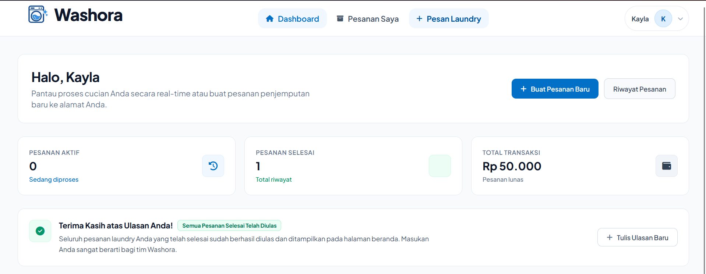
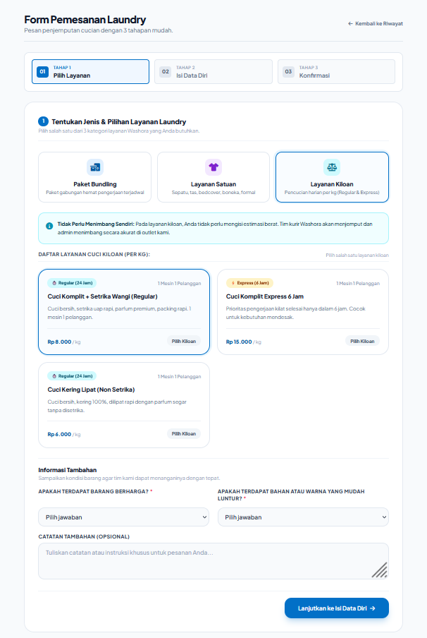
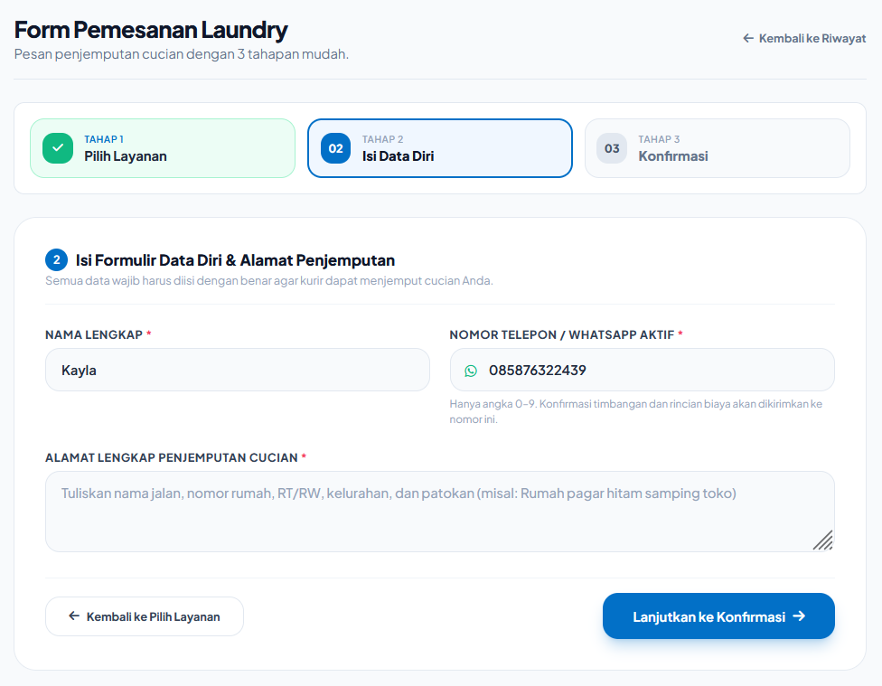
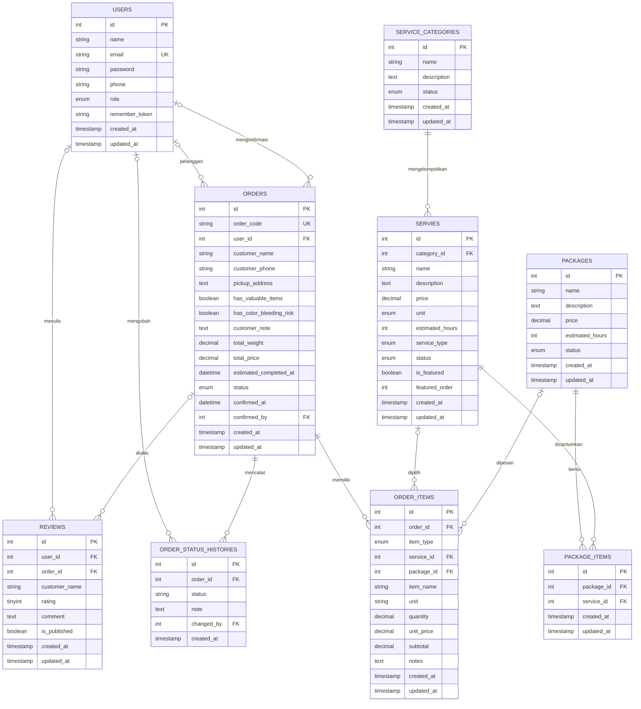
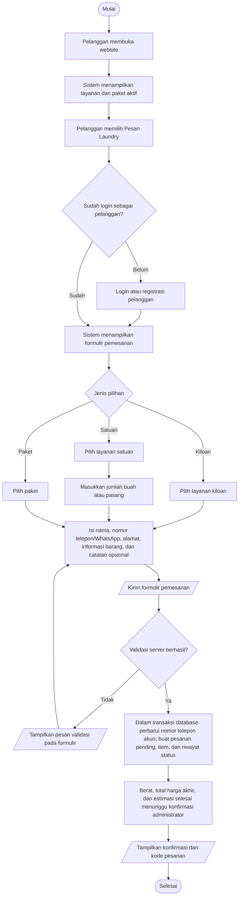
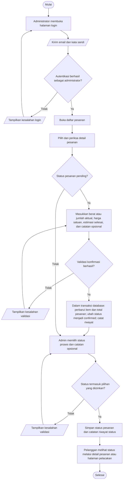
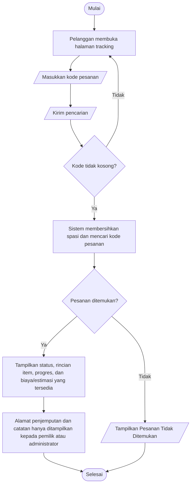

<p align="center">
  
</p>

<h1 align="center">Washora — Sistem Informasi Laundry</h1>

<p align="center">Aplikasi berbasis website untuk pemesanan dan pengelolaan layanan laundry.</p>

<p align="center">
  <a href="https://washora-laundry-system.wasmer.app">Website demo</a>
  ·
  <a href="https://github.com/kayla-pum/washora_laundry_system">Repository</a>
</p>

<p align="center">
  
  
  
  
</p>

## Tentang Washora

Washora adalah website untuk memesan layanan laundry dan memantau progres pesanan, sementara administrator mengelola katalog, pesanan, transaksi, dan laporan. Sistem ini dibuat untuk membantu proses laundry yang sebelumnya dilakukan secara manual menjadi lebih teratur, mudah dipantau, dan memiliki catatan pesanan.

## Fitur Utama

### Pelanggan

- Registrasi akun dan login.
- Melihat kategori, layanan, paket, dan layanan unggulan yang aktif.
- Memesan layanan kiloan, satuan (buah atau pasang), atau paket; pilihan reguler dan express mengikuti layanan yang tersedia.
- Mengisi alamat penjemputan, nomor telepon/WhatsApp, informasi barang, dan catatan pesanan.
- Melihat riwayat, rincian, status, dan biaya pesanan.
- Melacak pesanan menggunakan kode pesanan tanpa harus login.
- Mengirim ulasan dan testimoni. Ulasan yang dikirim langsung dipublikasikan; administrator dapat menyembunyikan atau menghapusnya.

### Administrator

- Melihat ringkasan operasional pada dashboard.
- Melihat data pelanggan dan riwayat pesanan.
- Mengelola kategori, layanan, paket, serta layanan unggulan dan urutannya.
- Memeriksa dan mengonfirmasi pesanan dengan memperbarui berat/jumlah, harga, dan estimasi selesai.
- Memperbarui status pesanan; perubahan dicatat dalam riwayat status.
- Melihat transaksi, mencetak invoice, dan melihat rekapitulasi laporan.
- Mencetak laporan atau mengunduh laporan transaksi dalam format PDF.
- Meninjau, menyembunyikan, dan menghapus testimoni.

## Tampilan Website

Gambar berikut merupakan dokumentasi antarmuka yang tersedia di `public/images/`.

### Pelanggan

<table>
  <tr>
    <td align="center"><br>Login</td>
    <td align="center"><br>Dashboard pelanggan</td>
  </tr>
  <tr>
    <td align="center"><br>Pilih layanan</td>
    <td align="center"><br>Data pemesanan</td>
  </tr>
  <tr>
    <td align="center"><br>Konfirmasi pesanan</td>
    <td align="center"><br>Riwayat pesanan</td>
  </tr>
</table>

### Administrator

<table>
  <tr>
    <td align="center"><br>Dashboard</td>
    <td align="center"><br>Pengelolaan pesanan</td>
  </tr>
  <tr>
    <td align="center"><br>Pengelolaan layanan</td>
    <td align="center"><br>Rekapitulasi laporan</td>
  </tr>
</table>

## Teknologi yang Digunakan

Versi di bawah mengikuti batasan versi pada manifest proyek. Dependency frontend tidak dikunci dalam `package-lock.json`.

| Teknologi | Versi pada proyek | Kegunaan |
|---|---|---|
| PHP | `^8.3` | Bahasa pemrograman sisi server |
| Laravel | `^13.17` | Framework aplikasi web |
| MySQL | Driver `mysql` pada konfigurasi contoh | Basis data; konfigurasi Laravel juga menyediakan driver MariaDB dan SQLite |
| Composer | Tidak ditentukan di manifest | Mengelola dependency PHP |
| Node.js dan npm | Tidak dipatok di manifest | Mengelola dependency dan membangun aset frontend |
| Vite | `^8.0` | Server pengembangan dan bundler aset frontend |
| Tailwind CSS | `^4.0` | Styling antarmuka |
| Laravel DomPDF | `^3.1` | Membuat dokumen laporan PDF |

## Persyaratan Sistem

- PHP 8.3 atau lebih baru beserta ekstensi PHP yang dibutuhkan Laravel dan driver database yang dipilih (misalnya `pdo_mysql` untuk MySQL).
- Composer.
- MySQL atau MariaDB yang dapat diakses aplikasi; konfigurasi contoh menggunakan MySQL pada port `3306`. SQLite juga tersedia sebagai driver dalam konfigurasi Laravel.
- Node.js dan npm yang kompatibel dengan Vite 8, hanya diperlukan untuk memasang dependency frontend dan membangun aset.
- Git untuk mengambil repository.

## Panduan Instalasi

1. Clone repository dan masuk ke direktori proyek:

   ```bash
   git clone https://github.com/kayla-pum/washora_laundry_system.git
   cd washora_laundry_system
   ```

2. Pasang dependency PHP:

   ```bash
   composer install
   ```

3. Pasang dependency frontend:

   ```bash
   npm install
   ```

4. Buat file `.env` dari contoh. Di PowerShell:

   ```powershell
   Copy-Item .env.example .env
   ```

   Di macOS/Linux atau Git Bash:

   ```bash
   cp .env.example .env
   ```

5. Atur koneksi database di `.env` sesuai lingkungan lokal, lalu buat database yang namanya sesuai dengan nilai `DB_DATABASE`.
6. Buat application key:

   ```bash
   php artisan key:generate
   ```

7. Jalankan migration dan seeder yang tersedia:

   ```bash
   php artisan migrate --seed
   ```

8. Bangun aset frontend dan jalankan server lokal:

   ```bash
   npm run build
   php artisan serve
   ```

   Buka `http://127.0.0.1:8000` di browser.

## Panduan Penggunaan

### Pelanggan

1. Buka halaman beranda, lalu pilih **Masuk** untuk login atau **Daftar Akun Baru** untuk registrasi.
2. Setelah login, buka **Dashboard** untuk melihat ringkasan pesanan dan transaksi.
3. Pilih **Pesan Laundry**, lalu tentukan jenis pesanan:
   - **Paket Bundling** untuk paket laundry yang tersedia.
   - **Layanan Satuan** untuk barang yang dihitung per buah atau pasang.
   - **Layanan Kiloan** untuk layanan yang dihitung per kilogram.
4. Isi nama, nomor WhatsApp, alamat penjemputan, informasi barang berharga atau risiko warna luntur, serta catatan tambahan.
5. Periksa kembali ringkasan pesanan, lalu kirim formulir.
6. Catat kode pesanan yang ditampilkan. Gunakan kode tersebut pada halaman **Pelacakan** atau buka menu **Pesanan Saya** untuk melihat riwayat dan rincian pesanan.
7. Setelah pesanan berstatus `completed`, pelanggan dapat memberikan rating dan testimoni pada halaman rincian pesanan.

### Administrator

1. Masuk melalui `/admin/login` menggunakan akun administrator.
2. Buka **Dashboard** untuk melihat pesanan menunggu verifikasi, proses laundry, pesanan siap diambil atau diantar, dan omset.
3. Buka **Pesanan Laundry**, pilih pesanan, lalu pada status `pending` masukkan berat atau jumlah aktual, harga satuan, estimasi selesai, dan catatan verifikasi.
4. Konfirmasi pesanan untuk mengubah status menjadi `confirmed`.
5. Gunakan menu status pada halaman detail untuk memperbarui pesanan menjadi `processing`, `washing`, `finishing`, `ready`, `completed`, atau `cancelled`.
6. Kelola kategori, layanan, paket, dan layanan unggulan dari menu **Katalog & Layanan**.
7. Buka **Data Pelanggan** untuk melihat pelanggan beserta riwayat pesanan.
8. Buka **Transaksi & Struk** untuk melihat transaksi dan mencetak invoice.
9. Buka **Laporan & Rekap** untuk melihat rekap periode, mencetak laporan, atau mengunduh PDF.
10. Buka **Testimoni Pelanggan** untuk menyembunyikan atau menghapus ulasan.

### Pelacakan Pesanan

Pengunjung dapat membuka halaman **Pelacakan**, memasukkan kode dengan format `WSH-YYYYMMDD-XXX`, lalu memilih **Cari Pesanan**. Sistem menampilkan status, rincian layanan, berat atau jumlah, estimasi selesai, biaya, dan riwayat perubahan status jika kode ditemukan.

## Akun Demo

Akun berikut disediakan oleh seeder proyek:

| Peran | Email | Kata sandi |
|---|---|---|
| Pelanggan | [user@washora.com](mailto:user@washora.com) | `password` |
| Administrator | [admin@washora.com](mailto:admin@washora.com) | `password` |

## Pengembang

Washora dikembangkan sebagai proyek tugas akhir pembelajaran Rekayasa Perangkat Lunak (RPL).

## ERD Sistem

ERD berikut dirangkum dari migration pada `database/migrations/` dan relasi Eloquent pada `app/Models/`. Nama tabel mempertahankan nama aktual proyek, termasuk tabel `servies`.



### Penjelasan tabel utama

| Tabel | Fungsi |
|---|---|
| `users` | Menyimpan akun pelanggan dan administrator. `role` membedakan hak akses, dan tabel ini menjadi pemesan, pengonfirmasi, penulis ulasan, serta pencatat status. |
| `service_categories` | Mengelompokkan layanan laundry. Satu kategori memiliki banyak layanan. |
| `servies` | Menyimpan katalog layanan, satuan, jenis regular/express, estimasi pengerjaan, status, dan pengaturan layanan unggulan. |
| `packages` | Menyimpan paket bundling beserta harga dan estimasi pengerjaan. |
| `package_items` | Menghubungkan paket dengan satu atau beberapa layanan. |
| `orders` | Menyimpan pesanan utama, alamat penjemputan, berat, harga, estimasi selesai, status, dan administrator pengonfirmasi. |
| `order_items` | Menyimpan rincian layanan atau paket pada pesanan beserta jumlah, harga satuan, subtotal, dan catatan. |
| `order_status_histories` | Mencatat perubahan status beserta pengguna yang mengubahnya. |
| `reviews` | Menyimpan ulasan pelanggan, rating, dan status publikasi testimoni. |

Harga dan subtotal menggunakan `decimal(12,2)`, sedangkan berat dan jumlah menggunakan `decimal(8,2)`. `users.email` dan `orders.order_code` bersifat unik. Kolom `user_id` pada pesanan dan ulasan dapat bernilai `null`, sedangkan pesanan aktif tetap memerlukan akun pelanggan pada alur pemesanan. `orders.customer_name` dan `orders.customer_phone` tersedia pada database, tetapi proses pemesanan saat ini belum mengisinya. Relasi pesanan dengan ulasan berbentuk one-to-one pada model, tetapi migration tidak memberikan constraint unik pada `reviews.order_id`.

### Tabel pendukung Laravel

| Tabel | Fungsi |
|---|---|
| `password_reset_tokens` | Menyimpan token reset kata sandi berdasarkan email. |
| `sessions` | Menyimpan sesi pengguna dan aktivitas. |
| `cache` | Menyimpan nilai cache dan waktu kedaluwarsa. |
| `cache_locks` | Menyimpan lock untuk cache database. |
| `jobs` | Menyimpan pekerjaan antrean. |
| `job_batches` | Menyimpan metadata batch antrean. |
| `failed_jobs` | Menyimpan antrean yang gagal dijalankan. |
| `migrations` | Dicatat oleh Laravel sebagai daftar migration yang telah dijalankan. |

## Flowchart Pemesanan Pelanggan

Alur berikut sesuai dengan route pelanggan yang dilindungi middleware `auth` dan `customer`, serta `User\OrderController`.

**Kode Mermaid:**



Pelanggan harus login untuk mengirim pesanan. Layanan kiloan belum memiliki subtotal akhir dan menunggu penimbangan admin, sedangkan layanan satuan menyimpan jumlah dan subtotal awal. Paket menyimpan satu item paket beserta harga paket.

## Flowchart Pengelolaan Pesanan Administrator

Alur berikut sesuai dengan route administrator, middleware `auth` dan `admin`, serta `Admin\OrderController`.

**Kode Mermaid:**



Setelah pesanan dikonfirmasi, administrator dapat memilih status `confirmed`, `processing`, `washing`, `finishing`, `ready`, `completed`, atau `cancelled`. Setiap perubahan dicatat dalam riwayat status. Tautan WhatsApp dibuka oleh administrator dan tidak dikirim otomatis oleh sistem.

## Flowchart Pelacakan Pesanan

Pelacakan tersedia untuk umum pada route `GET /tracking`.




Kode pesanan dicari setelah spasi di awal dan akhir dihapus. Alamat penjemputan serta catatan pelanggan disamarkan bagi pengunjung yang bukan pemilik pesanan atau administrator.
