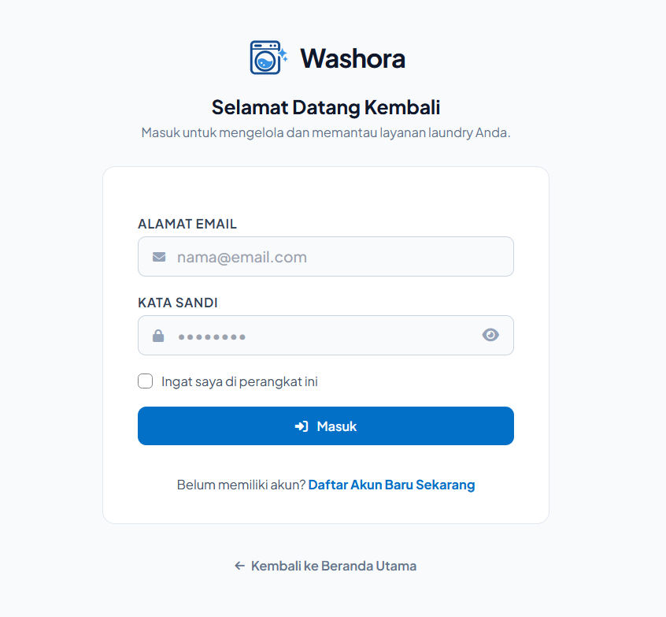
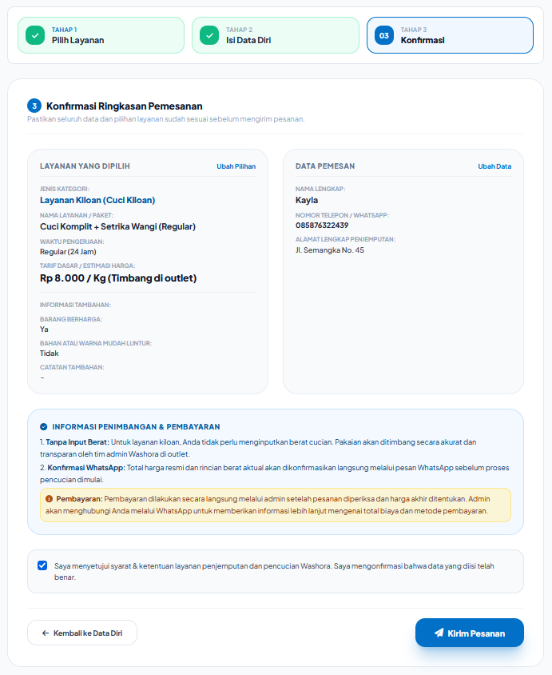
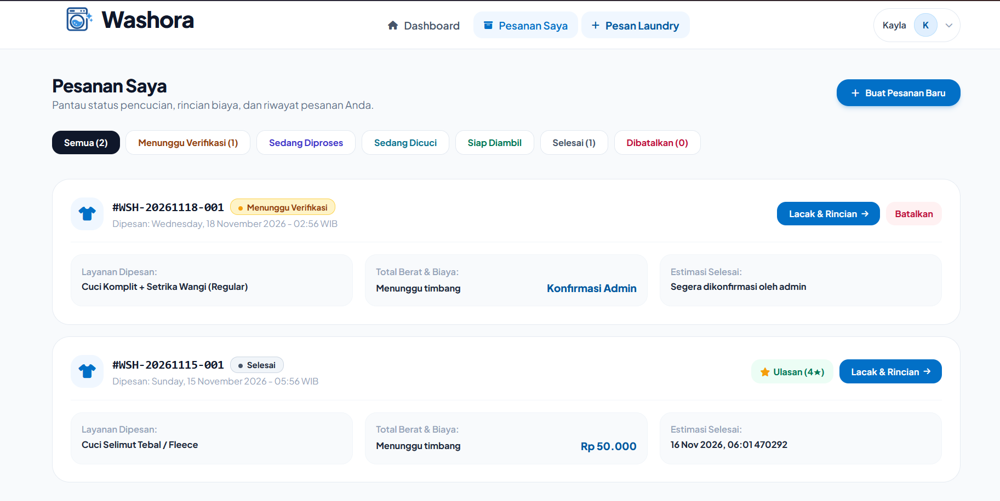
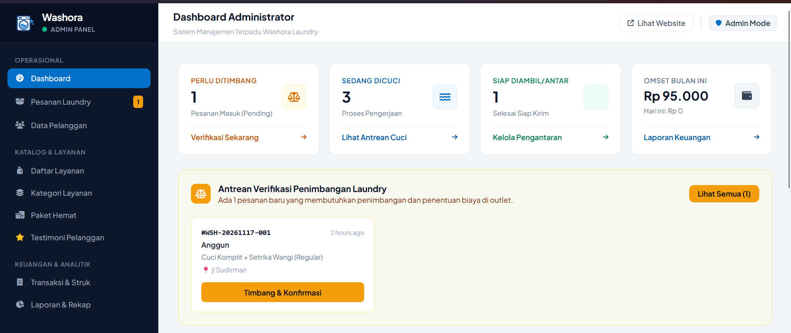
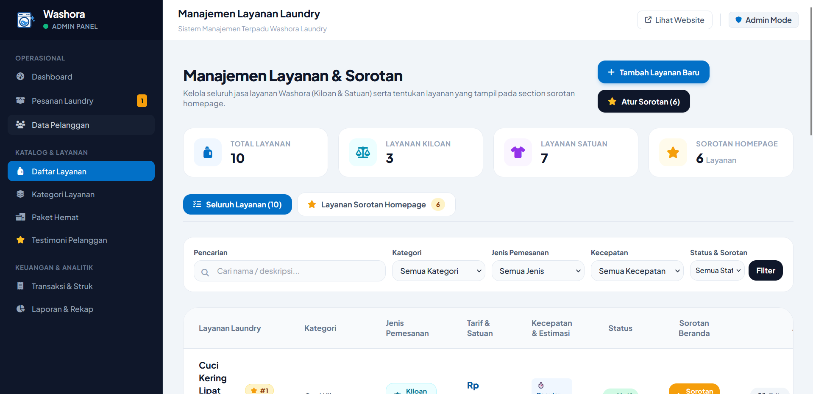
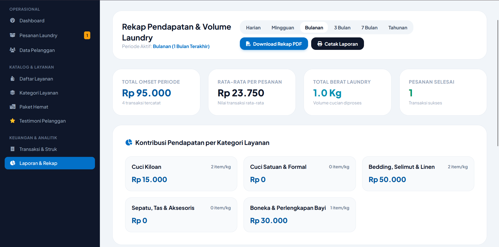

<p align="center">
  
</p>

<h1 align="center">Washora — Sistem Informasi Laundry</h1>

<p align="center">Aplikasi berbasis website untuk pemesanan dan pengelolaan layanan laundry.</p>

<p align="center">
  <a href="https://washora-laundry-system.wasmer.app">Website demo</a>
  ·
  <a href="https://github.com/kayla-pum/washora_laundry_system">Repository</a>
</p>

<p align="center">
  
  
  
  
</p>

## Tentang Washora

Washora adalah website untuk memesan layanan laundry dan memantau progres pesanan, sementara administrator mengelola katalog, pesanan, transaksi, dan laporan. Sistem ini dibuat untuk membantu proses laundry yang sebelumnya dilakukan secara manual menjadi lebih teratur, mudah dipantau, dan memiliki catatan pesanan.

## Fitur Utama

### Pelanggan

- Registrasi akun dan login.
- Melihat kategori, layanan, paket, dan layanan unggulan yang aktif.
- Memesan layanan kiloan, satuan (buah atau pasang), atau paket; pilihan reguler dan express mengikuti layanan yang tersedia.
- Mengisi alamat penjemputan, nomor telepon/WhatsApp, informasi barang, dan catatan pesanan.
- Melihat riwayat, rincian, status, dan biaya pesanan.
- Melacak pesanan menggunakan kode pesanan tanpa harus login.
- Mengirim ulasan dan testimoni. Ulasan yang dikirim langsung dipublikasikan; administrator dapat menyembunyikan atau menghapusnya.

### Administrator

- Melihat ringkasan operasional pada dashboard.
- Melihat data pelanggan dan riwayat pesanan.
- Mengelola kategori, layanan, paket, serta layanan unggulan dan urutannya.
- Memeriksa dan mengonfirmasi pesanan dengan memperbarui berat/jumlah, harga, dan estimasi selesai.
- Memperbarui status pesanan; perubahan dicatat dalam riwayat status.
- Melihat transaksi, mencetak invoice, dan melihat rekapitulasi laporan.
- Mencetak laporan atau mengunduh laporan transaksi dalam format PDF.
- Meninjau, menyembunyikan, dan menghapus testimoni.

## Tampilan Website

Gambar berikut merupakan dokumentasi antarmuka yang tersedia di `public/images/`.

### Pelanggan

<table>
  <tr>
    <td align="center"><br>Login</td>
    <td align="center"><br>Dashboard pelanggan</td>
  </tr>
  <tr>
    <td align="center"><br>Pilih layanan</td>
    <td align="center"><br>Data pemesanan</td>
  </tr>
  <tr>
    <td align="center"><br>Konfirmasi pesanan</td>
    <td align="center"><br>Riwayat pesanan</td>
  </tr>
</table>

### Administrator

<table>
  <tr>
    <td align="center"><br>Dashboard</td>
    <td align="center"><br>Pengelolaan pesanan</td>
  </tr>
  <tr>
    <td align="center"><br>Pengelolaan layanan</td>
    <td align="center"><br>Rekapitulasi laporan</td>
  </tr>
</table>

## Teknologi yang Digunakan

Versi di bawah mengikuti batasan versi pada manifest proyek. Dependency frontend tidak dikunci dalam `package-lock.json`.

| Teknologi | Versi pada proyek | Kegunaan |
|---|---|---|
| PHP | `^8.3` | Bahasa pemrograman sisi server |
| Laravel | `^13.17` | Framework aplikasi web |
| MySQL | Driver `mysql` pada konfigurasi contoh | Basis data; konfigurasi Laravel juga menyediakan driver MariaDB dan SQLite |
| Composer | Tidak ditentukan di manifest | Mengelola dependency PHP |
| Node.js dan npm | Tidak dipatok di manifest | Mengelola dependency dan membangun aset frontend |
| Vite | `^8.0` | Server pengembangan dan bundler aset frontend |
| Tailwind CSS | `^4.0` | Styling antarmuka |
| Laravel DomPDF | `^3.1` | Membuat dokumen laporan PDF |

## Persyaratan Sistem

- PHP 8.3 atau lebih baru beserta ekstensi PHP yang dibutuhkan Laravel dan driver database yang dipilih (misalnya `pdo_mysql` untuk MySQL).
- Composer.
- MySQL atau MariaDB yang dapat diakses aplikasi; konfigurasi contoh menggunakan MySQL pada port `3306`. SQLite juga tersedia sebagai driver dalam konfigurasi Laravel.
- Node.js dan npm yang kompatibel dengan Vite 8, hanya diperlukan untuk memasang dependency frontend dan membangun aset.
- Git untuk mengambil repository.

## Panduan Instalasi

1. Clone repository dan masuk ke direktori proyek:

   ```bash
   git clone https://github.com/kayla-pum/washora_laundry_system.git
   cd washora_laundry_system
   ```

2. Pasang dependency PHP:

   ```bash
   composer install
   ```

3. Pasang dependency frontend:

   ```bash
   npm install
   ```

4. Buat file `.env` dari contoh. Di PowerShell:

   ```powershell
   Copy-Item .env.example .env
   ```

   Di macOS/Linux atau Git Bash:

   ```bash
   cp .env.example .env
   ```

5. Atur koneksi database di `.env` sesuai lingkungan lokal, lalu buat database yang namanya sesuai dengan nilai `DB_DATABASE`.
6. Buat application key:

   ```bash
   php artisan key:generate
   ```

7. Jalankan migration dan seeder yang tersedia:

   ```bash
   php artisan migrate --seed
   ```

8. Bangun aset frontend dan jalankan server lokal:

   ```bash
   npm run build
   php artisan serve
   ```

   Buka `http://127.0.0.1:8000` di browser.

## Akun Demo

Akun berikut disediakan oleh seeder proyek:

| Peran | Email | Kata sandi |
|---|---|---|
| Pelanggan | [user@washora.com](mailto:user@washora.com) | `password` |
| Administrator | [admin@washora.com](mailto:admin@washora.com) | `password` |

## Pengembang

Washora dikembangkan sebagai proyek tugas akhir pembelajaran Rekayasa Perangkat Lunak (RPL).

Dokumentasi database dan alur sistem tersedia di [`docs/`](docs/).
