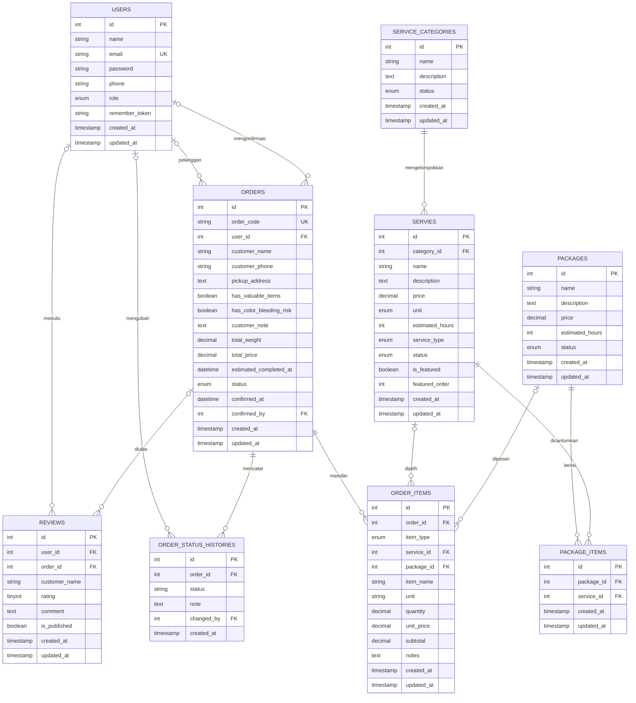

# ERD Washora

Diagram ini dirangkum dari migration pada `database/migrations/` dan relasi Eloquent pada `app/Models/`. Nama tabel dan kolom mempertahankan nama yang digunakan proyek; termasuk `servies`.

## Tabel utama aplikasi

### Fungsi dan hubungan

| Tabel | Fungsi dan keterkaitan |
|---|---|
| `users` | Menyimpan akun pelanggan dan administrator, dibedakan oleh `role`. Menjadi referensi pemesan, pengonfirmasi, penulis ulasan, dan pencatat perubahan status. |
| `service_categories` | Kategori katalog. Satu kategori memiliki banyak baris `servies`. |
| `servies` | Katalog layanan dengan satuan `kg`, `pcs`, atau `pair`; jenis layanan `regular` atau `express`; dan atribut sorotan. Nama tabel ini memang ditulis `servies` di migration. |
| `packages` | Paket laundry yang dapat dipesan. |
| `package_items` | Tabel penghubung paket dengan layanan; kedua FK membentuk relasi many-to-many antara `packages` dan `servies`. |
| `orders` | Data utama pesanan, kode unik, informasi penjemputan, nilai akhir, estimasi, status, serta akun yang membuat/mengonfirmasi pesanan. |
| `order_items` | Rincian layanan atau paket pada pesanan, termasuk nama snapshot, jumlah, harga, subtotal, dan catatan. |
| `order_status_histories` | Catatan perubahan status pesanan beserta pengguna yang mencatatnya dan waktu perubahan. |
| `reviews` | Ulasan pelanggan dan status publikasinya; ulasan dapat terkait ke akun dan/atau pesanan. |

Tipe yang dipersingkat pada diagram mengikuti definisi migration: `id` menggunakan integer auto-increment; harga dan subtotal memakai `decimal(12,2)`, berat/jumlah memakai `decimal(8,2)`, rating memakai `unsignedTinyInteger`, dan kolom teks/panjang mengikuti definisi masing-masing migration. `users.email` dan `orders.order_code` unik. Kolom yang ditambahkan sebagai nullable atau memiliki default: `users.phone`; `servies.description`, `featured_order`; `packages.description`; `orders.user_id`, `customer_name`, `customer_phone`, `customer_note`, `total_weight`, `total_price`, `estimated_completed_at`, `confirmed_at`, `confirmed_by`, `has_valuable_items`, `has_color_bleeding_risk`; `order_items.service_id`, `package_id`, `notes`; `order_status_histories.changed_by`; dan `reviews.user_id`, `order_id`. Kolom deskripsi kategori juga nullable.

FK `orders.user_id`, `orders.confirmed_by`, `order_status_histories.changed_by`, dan FK pada `reviews` bersifat nullable. Form pemesanan yang aktif tetap berada di route pelanggan dengan middleware `auth` dan `customer`. `orders.customer_name` dan `orders.customer_phone` tersedia pada skema, tetapi proses pemesanan saat ini tidak mengisi kedua kolom tersebut. Relasi `Order::review()` didefinisikan `hasOne`, sementara migration tidak memberi constraint unik pada `reviews.order_id`; alur kirim ulasan pelanggan memeriksa ulasan yang sudah ada, tetapi keunikan tidak dijamin oleh database.

## Tabel pendukung Laravel

Tabel berikut berasal dari migration framework dan tidak memiliki relasi FK yang didefinisikan di migration proyek:

| Tabel | Kunci dan kolom utama | Kegunaan |
|---|---|---|
| `password_reset_tokens` | `email` (PK), `token`, `created_at` | Penyimpanan token reset kata sandi Laravel. |
| `sessions` | `id` (PK), `user_id` (nullable, indexed), `ip_address`, `user_agent`, `payload`, `last_activity` | Penyimpanan sesi. `user_id` bukan FK dalam migration ini. |
| `cache` | `key` (PK), `value`, `expiration` | Cache berbasis database. |
| `cache_locks` | `key` (PK), `owner`, `expiration` | Lock untuk cache database. |
| `jobs` | `id` (PK), `queue`, `payload`, `attempts`, `reserved_at`, `available_at`, `created_at` | Antrean pekerjaan database. |
| `job_batches` | `id` (PK), `name`, `total_jobs`, `pending_jobs`, `failed_jobs`, `failed_job_ids`, `options`, `cancelled_at`, `created_at`, `finished_at` | Metadata batch antrean. |
| `failed_jobs` | `id` (PK), `uuid` (unik), `connection`, `queue`, `payload`, `exception`, `failed_at` | Pekerjaan antrean yang gagal. |

Laravel juga membuat tabel `migrations` untuk mencatat migration yang sudah dijalankan saat `php artisan migrate`; tabel tersebut bukan dibuat oleh file migration aplikasi di repository ini. File `.env.example` memilih MySQL, serta driver database untuk session, cache, dan queue.
