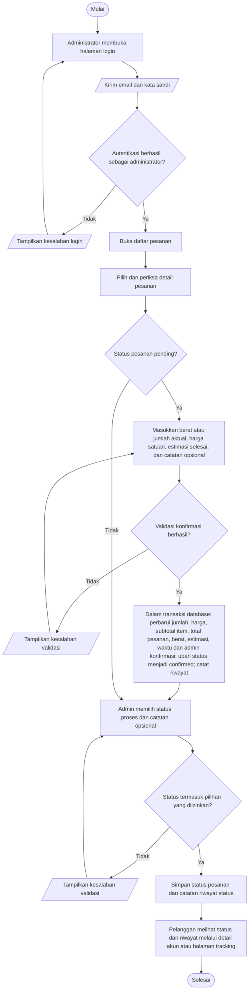

# Flowchart Pengelolaan Pesanan Administrator

Alur ini mengikuti route administrator, middleware `auth` dan `admin`, serta `Admin\OrderController`. Form timbang dan konfirmasi ditampilkan pada halaman detail untuk pesanan berstatus `pending`.

Konfirmasi menghitung harga dari jumlah aktual dan harga satuan yang dikirim administrator serta menyimpan semua perubahan konfirmasi dalam transaksi database. Setelah konfirmasi, administrator dapat memperbarui status ke nilai yang didukung (`confirmed`, `processing`, `washing`, `finishing`, `ready`, `completed`, atau `cancelled`). Tautan notifikasi WhatsApp dibuat untuk dibuka oleh administrator; pesan tidak dikirim otomatis oleh aplikasi.
