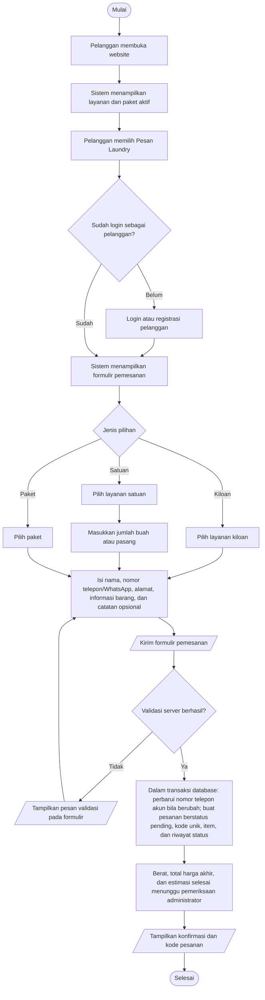

# Flowchart Pemesanan Pelanggan

Alur ini mengikuti route `/layanan`, route pelanggan yang dilindungi middleware `auth` dan `customer`, serta `User\OrderController`. Form mengirim satu layanan atau satu paket per pesanan.

Pelanggan harus memiliki sesi login untuk membuka formulir dan mengirim pesanan. Layanan kiloan dibuat dengan jumlah awal `1` dan subtotal `0` sambil menunggu penimbangan; layanan satuan menyimpan jumlah serta subtotal awal; paket menyimpan satu item paket dengan harga paket. Total akhir dan estimasi selesai ditentukan saat administrator mengonfirmasi pesanan. Input nama pemesan divalidasi pada formulir, tetapi kode penyimpanan pesanan saat ini tidak menyalinnya ke kolom `orders.customer_name`.
