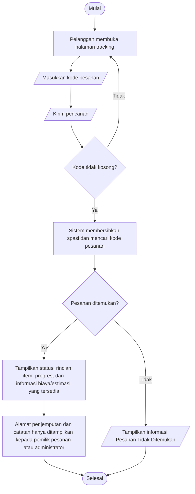

# Flowchart Pelacakan Pesanan

Pelacakan tersedia untuk umum pada route `GET /tracking`. Kode pesanan dicari persis setelah spasi di awal dan akhir dihapus.

Kolom kode pada halaman tracking wajib diisi di browser. Jika kosong, halaman tidak menjalankan pencarian. Status pesanan yang ditemukan mencakup riwayat status; alamat penjemputan dan catatan pelanggan disamarkan bagi pengunjung yang bukan pemilik pesanan atau administrator.
